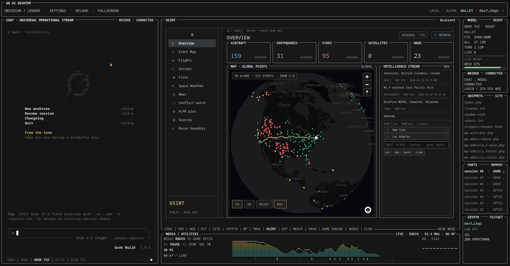

# GG AI Desktop



Public repo: [github.com/GoldGoblins/GG](https://github.com/GoldGoblins/GG)

## Installation and application files

The complete application lives in this directory. It includes `AGENTS.md`,
all seven GG GPT knowledge packages, the four GG skills and their shared
support modules. [FILE-LAYOUT.md](FILE-LAYOUT.md) describes the directories,
installation and provider dependencies. `FILE-CATALOG.json` inventories the
current distributable sources.

```bash
python3 -m venv .venv
.venv/bin/pip install -r requirements.txt
.venv/bin/python gg-setup --prepare
PYTHON="$PWD/.venv/bin/python" ./run-gg-ai-desktop.sh
```

Install and sign in to Codex for GPT TUI or Grok Build for GROK TUI. External
provider plugins are cataloged in `config/dependencies.json` and installed
through their respective provider clients.

## Patch notes · 2026-10-12 · GG AI Desktop updates since 2026-09-24

**Chat and desktop.** Shared GROK TUI, GPTUI and FLOW TUI sessions now have
updated history handling, context compilation and input behavior. The desktop
also includes settings, workspace controls and task-scoped operator updates.
The startup launcher paints the desktop before loading the Python backend.

**RESEARCH.** Research, the QIP/WASM lab and GAMES share one workspace with
supervised jobs and retained working state. The tools add asset discovery,
dependency tracking, bounded collection batches, source context, candidate
verification, route editing, rig trials and scene profiling. GPT, Grok,
command-line tools and Blender use the same workflows.

**OSINT.** The globe adds optional terrain and buildings, progressive feed
loading and Swedish news. Navigation adds own-position accuracy, FOLLOW and
route guidance. Optional nearby-radio information uses existing local
NetworkManager/BlueZ caches with visible freshness information.

**GAME ENGINE.** The engine workspace updates its shared renderer, camera,
input and traversal handling, bounded asset import and dependency validation.
Native world and presentation adapters, Lua/UI integration and inspection tools
extend the engine's existing simulation and rendering interfaces.

**CRYPTO.** The crypto workspace adds portfolio views, paper-bot improvements,
strategy and indicator updates, and stronger handling of unreliable inputs.

**EXT and tools.** Blender integration and shared authoring/analysis helpers
are updated. Live visual observation is available through the desktop tools.

Update with `git pull` and restart GG AI Desktop to load the new backend.


## Patch notes · 2026-10-10 · local asset workflow improvements

The [implemented priorities and verification](docs/local-asset-improvements-2026-10-10/REPORT.txt)
extend the earlier corpus study. The editor and runtime now use one local
resource policy for shared buffers; editor metadata/image caches also observe
external buffer/image changes. Scout reads bounded OBJ topology, DAE skin and
id/name/sid aliases, SMD pose samples and checked GGFLORA1 vertices/indices.
Document, buffer, image and material-library identities form a dependency graph;
annotations bind to that complete identity. Incomplete references stay visible
as incomplete, and changed dependencies exclude stale matches.

The app's catalog contains 25,930 entries from 24 collections, built in 225
bounded batches. Twelve oversized authoring files, nine incomplete reference
models and one unreadable existing image are explicitly reported. Source
stamps stayed unchanged. A keyed FTS row mapping avoids scanning the entire
catalog for each update; refreshing all search rows took about 2.3 seconds in the
recorded run. Collections commit only after all batches and source checks pass.

RESEARCH → GAMES adds collection planning, batch continuation/discard, dependency
links, **Rig trial** and **Scene profile**. Rig trial creates a separate GLB
with explicit caller FPS/basis, preserved corner normals/UVs/material groups,
raw weights and coincident faces. Qwark matched 92 joint aliases and retained
3,190 triangles across bind/first/middle/last Blender samples. Helga's two
inconsistent bind matrices produce a diagnostic failure before conversion.
Neither name matching nor a successful preview automatically retargets a GG rig.

Scene profile prepares an admitted model/LOD plan; **MEASURE QT** runs a finite
separate View3D window through the supervised worker. A three-model OpenGL
sample measured 16 draw calls in FULL, 11 in VISIBILITY, and 16 in LOD. GPU
timing was unavailable and remains explicit; source triangle/material counts
are kept separate from measured counters. Original native readers, animation
clocks and game-reference files retain their existing behavior and bytes.

```bash
python3 gg-game-workflows scout-collections qml/assets
python3 gg-game-workflows scout-search rigg --game 'GG local library' --kind model
python3 gg-game-workflows scout-batch qml/assets/authored/flora --game GG
python3 gg-game-workflows asset-profile qml/assets/authored/characters/gg-crew-briarstride-articulated.glb --lod qml/assets/authored/characters/gg-crew-briarstride-compact.glb
```

Batch results carry a continuation cursor for the next CLI call; GAMES retains
it internally. A collection plan specifies recursive/shallow and hash-partition
parameters for large flat directories. Rig trials require `--fps` and `--basis`;
neither is guessed from an undeclared SMD. The Blender reviewer is
`tools/blender/verify_game_rig_trial.py`; scene plans also run with
`tools/research/profile_game_asset_scene.py`. Updated desktop sources must be
loaded for the new controls; the command line works immediately.

## Patch notes · 2026-10-10 · game independent asset and analysis workflows

RESEARCH → GAMES now shares four workflows between the desktop, GPT/Grok tools
and Blender: discover assets, assemble function context, review a candidate,
and author routes. The original requirement is to reuse the working steps across
PS2, RenderWare, WoW, Jak, Ratchet, Vexx, Sly and other games. A game label records
provenance; the file format and its version select the reader.

These are GG implementations of the workflows reviewed in
[GTA Scout](https://github.com/Dryxio/gta-scout),
[Ghidra Bridge](https://github.com/Dryxio/ghidra-bridge),
[Reagent](https://github.com/Dryxio/reagent) and
[GTA Flow](https://github.com/Dryxio/gta-flow).
The upstream packages are not installed or vendored by this change. No game
assets or model weights are bundled. Existing GG Ghidra jobs, GgEngine readers,
asset validation and Blender authoring remain the integration points.

| Workflow | Implemented behavior | Practical scope |
| --- | --- | --- |
| Scout | Incremental SQLite/FTS5 catalog, Swedish/English lexical hints, game/kind filters, source-bound annotations, stale-file exclusion, distinct duplicate locations, pixel contact sheets | Metadata and evidence retrieval; semantic embeddings and automatic model rendering are not installed |
| Function context | Reuses completed local function/decompile/xref jobs; accepts exact-name/address offline JSON exports; carries available dependencies, types, P-code, CFG and assembly | Address spaces and 64-bit addresses are preserved; imported exports retain unverified provenance |
| Candidate review | Stores a separate candidate packet, checks simple source structure and representable integer returns, optionally compiles C11 syntax inside network-isolated bubblewrap | Behavior remains UNKNOWN without an independent test; no automatic source patch or acceptance |
| Route authoring | Stable node/edge/route IDs, explicit units and axes, directed traversal, 3D paths, loops, ping-pong and dwell steps, deterministic compilation and an independent serialized-graph checker | GG world/settlement adapters preserve stop metadata and authoring scale; proprietary game route tables require their own adapter |

The initial format adapters inspect glTF/GLB document metadata, image headers,
RenderWare chunk structure, M2/BLP headers and ELF architecture/entry identity.
The optional WoW reader uses the installed, verified GgEngine implementation for
its supported versions. RenderWare native PS2 geometry/raster plugins, later WoW
variants and title-specific Jak/Ratchet/Vexx/Sly archives are not silently decoded
through a GTA reader. Extracted common-format assets use the same workflow;
unrecognized files remain explicitly opaque. A MIPS ELF header identifies an
architecture, not a verified PS2 runtime.

A [local asset and GgEngine study](docs/local-asset-study-2026-10-10/REPORT.txt)
now measures 25,942 existing asset files, exported rigs and separate animation
resources. Its [geometry comparison](docs/local-asset-study-2026-10-10/mesh-study.png)
and saved evidence identify shared-resource editor rejection, layered faces and
the missing OBJ/DAE/GG mesh catalog metadata. These are measured findings and
priorities; the later implementation above addresses them while the original
study remains a record of the earlier state.

The new surface is available when the desktop loads the updated sources. The
shared command line is usable immediately from the workspace root:

```bash
python3 gg-game-workflows tools
python3 gg-game-workflows scout-index qml/assets/authored/props --game GG
python3 gg-game-workflows scout-search grapple --game GG
python3 gg-game-workflows flow-import qml/assets/authored/world/world-places.json --game GG
python3 gg-game-workflows --help
```

GAMES → Function context can collect the last completed function analysis from
REVERSE. For an offline export, select its function JSON or a bounded export
directory, select the original artifact, and supply the exact name or address.
Function files accept `name`/`full_name`, `address`, `pseudocode`/`decompiled`/
`decompiled_code`/`code`, and optional `callers`, `callees`, `strings`, `globals`,
`types`, `pcode`, `cfg` and `asm` fields. Selection attaches an unbound external
export to the chosen artifact; it does not verify that export's producer.

Use the saved context packet in Candidate review and select one proposed C/C++
function. The optional compiler gate checks C11 syntax only. Its result does not
test linking, game ABI, MIPS/vector-unit behavior or memory effects. Candidate
commands return a nonzero exit code while acceptance is UNKNOWN or REJECTED so
automation cannot treat structural consistency as successful reconstruction.

Generic route files use `gg.game-workflows.flow.v1`, with explicit `coordinates`
(`up` Y/Z, `handedness` right/left, `meters_per_unit`), `nodes`, `edges` and
`routes`. Node positions have three components. Edges name their `from` and `to`
node IDs and can include a polyline, `directed`, `width_m` and an arbitrary agent
label. Widths use world metres; input positions use the declared scale. Left
handed input mirrors X before axis conversion. Crossings never imply junctions.
Coincident activity stops use explicit DWELL transitions; zero-length MOVE
segments are rejected. The checker verifies graph structure and traversal,
not collision or game-engine behavior.

In Blender, [gg_game_workflow_routes.py](tools/blender/gg_game_workflow_routes.py)
imports a flow packet into a new collection of tagged nodes and editable POLY
curves. `export_flow(collection)` previews and validates; `apply=True` saves a
new workflow packet. Renaming an object preserves its ID. Shared endpoint edits
must agree. A changed source requires reimport. GG map export writes a separate
candidate and rejects edits that its 2D map schema cannot preserve. It never
replaces the live map; applying a reviewed candidate uses the established map
authoring/build pipeline.

Workers admit one job at a time, have a 60-second wall limit and retain eight
job records. Each scan is limited to 2,048 files, 256 MiB total and 32 MiB per
file; the catalog holds up to 8,192 occurrences. Oversized files are reported as
skipped. A scan that exceeds its file/byte/time budget preserves the previous
catalog. Evidence packets are limited to 512 files/64 MiB and fail explicitly
when full instead of silently deleting saved evidence. Source bytes are checked
again before retrieval, annotation, context reuse and visual evidence creation.

Validation covers cross-format fixtures, changed files, export ambiguity,
RenderWare length errors, actual GgEngine BLP/M2 decoding, isolated compiler
syntax, independent route-output corruption, real GG map round trips, actual
QML buttons/workers, actual Blender curves and local Ghidra context creation:

```bash
python3 -B -m unittest discover -s tests -p test_game_workflows.py
python3 -B tests/test_game_workflows_ui.py
python3 -B tests/test_game_workflows_engine.py
# Run with the installed Blender executable:
blender --background --factory-startup --python-exit-code 1 --python tests/test_game_workflows_blender.py
```

## Patch notes · 2026-10-01 · own position, NAV guidance and nearby radios

OSINT now offers an explicit POS switch, an own-position marker with reported
accuracy, and FOLLOW in NAV. Planned road maneuvers, remaining distance and
arrival use the existing OSRM route. Approximate, stale and off-route positions
are distinguished. Manual panning releases camera following.

Overview position uses lower accuracy and throttled marker updates. NAV routes
or zoom 15 and above enable detailed position mode; hiding the globe disposes
the location watcher. Optional NEARBY reads existing NetworkManager/BlueZ cache
on a worker only in those detailed views, with unknown cache age shown. It does
not estimate other devices' locations or identify trackers. See the
[Fieldwatch reference and implementation checks](docs/OSINT_NAV_POSITION_NEARBY.md).

## Patch notes · 2026-10-01 · OSINT globe and Swedish news

The existing MapLibre globe now has optional elevation terrain with hillshade
and 3D buildings. Terrain is fetched only when enabled and zoomed in; building
volumes use the existing basemap. Map updates coalesce and avoid unchanged
source uploads, and the optional basemap loads alongside the local globe.
Feed results appear progressively instead of waiting for the slowest source.

The intelligence panel now separates news from signals and offers a Swedish
filter. SVT, SR Ekot and BBC World retain publisher, publication time and
per-feed cache status. Headlines wrap, panels remain readable over detailed
maps, and source health exposes each news feed. See the
[Osiris comparison and verification](docs/OSINT_GLOBE_COMPARISON.md).

## Patch notes · 2026-10-01 · OSINT, Research and QIP

OSINT now contains Research and QIP subpages using the existing components.
Selected feed observations can be saved to Research with source, collection
time, event time and location precision preserved. Reference locations stay
references; observations await independent corroboration. Repeated saves of
the same record do not create duplicate evidence cards.

Source health distinguishes fetch attempts from successful retrievals, ages
cached records, and reports partial camera failures. ADS-B fallback records
retain their actual provider. Analysis pages preserve their local drafts and
file selection while navigating inside OSINT and do not refresh public feeds.
The map engine pauses while those analysis pages are visible. Research now
exposes its imported source library. Existing standalone tabs remain available.

The [research and implementation note](docs/OSINT_RESEARCH_INTEGRATION.md)
explains the derivation from existing code and the assessment of NSA projects,
including Ghidra, LemonGraph, DataWave, Emissary and QGIS plugins.

## Patch notes · 2026-09-26 · grapple swing and authored locomotion

Q launches a visible grappling hook toward a clear anchor. The hook travels
before it attaches; pressing Q again releases the rope. Its 428-triangle head
is authored and exported through Blender. A fixed-step pendulum keeps swing
momentum, allows directional pumping and resolves against the island's ground
height. Space supports a second air-jump impulse with its own short
Blender-authored somersault. The nine original GG character exports now carry
the shared 90-bone rig and eleven Blender-authored motion clips. No proprietary
game assets are included.

## Patch notes · 2026-09-26 · first Sandover exploration route

The separate game client now offers quests from the nearby character who gives
them and keeps the current objective, progress and distance in a field journal.
Two starting expeditions let the player choose the west windmill ridge or the
south cove; the cove route continues past its waterwheel to a new Blender-built
tide beacon. Visit triggers use the same world coordinates and ground movement
as the shared terrain and navigation; the beacon also has a simulation
collision. No screenshot is included.

## Patch notes · 2026-09-26 · trailing camera and freer movement

The third-person camera now follows the player's heading and stays behind the
character by default; right-mouse orbit remains available around the player.
W/S move forward and backward while A/D always rotate the character, whether
standing or moving. E interacts with the world; Q fires or releases the
grappling hook. Jumps support a short input buffer, a small ledge grace window,
variable height while Space is held, and a second jump in mid-air. No new
image asset is included in this patch.

## Patch notes · 2026-09-25 · cove village and island terrain

The GAME ENGINE's first island now has a distinct sheltered cove, low village
green, raised windmill headland and an uneven coastline. One continuous height
field still drives the rendered ground, movement, navigation and water depth.
Near terrain blends beach, grass and exposed rock with per-vertex colors; far
HLOD tiles keep their small shared biome palette.

The original 32-prop scene now uses four roof silhouettes and colors across
the enterable stilt huts, a market stall, fish rack, skiff, connected boardwalk
and pier, stone steps, a shrine, barrel, rock outcrops, palms and mangroves.
Existing house deck, doorway, collision and prop-pool limits stay intact. The
village layout is informed by reachable landmarks and readable routes in classic
adventure worlds; it uses original GG geometry and does not copy game assets.
No screenshot or new image asset is included in this patch.

## Patch notes · 2026-09-24 · shared sequential FLOW TUI

**FLOW TUI.** GROK TUI and GPTUI share one task ledger in the same chat and
take distinct turns: GROK scopes and assigns the work, GPTUI completes that
assignment, and GROK reviews it. If review finds a gap, FLOW allows one GPTUI
repair pass and one final GROK review. Missing handoffs, timeouts, and truncated
responses stay explicitly incomplete. Each turn receives the original request,
the prior handoff and work, recent FLOW context, and matching shared-memory
lessons. Only one motor is active at a time.

## Patch notes · 2026-09-10 · wallet box, CRYPTO desk, FLOW TUI, house chrome

What GitHub had until this push: same-task thought desk, paper CRYPTO DESK,
WEB hang guard, OSINT globe, GAME ENGINE, QIP lab, FACTORY/POLY research and
OmniGPT profiles.

**House chrome is wallet-quality boxes.** Frames are real rectangles: even
1 px `#4a4a4a`, radius 4, antialiased corners. Hanging legends sit *on* the
border (CHAT · UNIVERSAL OPERATIONAL STREAM, CODE tabs, MEDIA / UTILITIES),
not on an inner title strip. That is the default for every box, not a
one-off for wallet.

**Wallet is a window.** The top-bar `WALLET` chip opens a real overlay.
`WALLET` goes green when an account is connected; the address is the
logged-in signal. Drag by the six-dot grip (`⋮⋮`) left of close. Close with
`✕` or the chip. Clicking elsewhere does not dismiss it. Solana TESTNET /
OBSERVE lives in the wallet. The CRYPTO rail lists known accounts (green =
active); click to switch. CREATE / IMPORT / CONNECT adds to that list. No
SIGNER badge. WATCH only appears as `addr · WATCH` when there is no key on
disk.

**CRYPTO nav matches TMOG / OSINT.** Left sidebar with accordion children:
books under Backtest and Trader, Kaspa Paper / Kaspa TN / Kaspa live,
Polymarket SUMMARY / TRADES / TOUCH / SCAN. Mainnet is observe-only; sends,
airdrop and arb stay on testnet/lab. Kaspa paper Counter covenant is the
UTXO analog of the Solana lab (successor output, covenant id stays). Tape
keeps the chart engine alive and skips identical payloads so the SOL spark
does not flicker.

**FLOW TUI.** Additive motor after GPTUI. Two named motors in one house,
merge, then a reflect pass. GROK TUI and GPTUI stay usable if FLOW breaks.
The chat legend is still `CHAT · UNIVERSAL OPERATIONAL STREAM`.

**Long memory.** Compact lessons on the laser-Merkle tree. `/flush` writes
session notes; `/dream` rebuilds the bounded working set. Idle learn stays
local; a bounded public GET tick exists for allowlisted feeds.

**Screenshot.** `docs/gg-ai-desktop.png` is this drop: wallet box, hanging
legends, CRYPTO rail accounts, GROK TUI, MEDIA/UTILITIES.

Unchanged: GROK TUI as default motor, no GGUF in git, `PARALLEL_AGENT_BRAIN`
forbidden, `GENERAL_ACTION_AUTHORITY` NONE. Python host edits still need a
desktop restart; QML often RELOAD. Live sends stay off.

## Patch notes · 2026-09-09 · same-task desk, paper trading desk, WEB hang guard

What GitHub had until this push: the OSINT globe, GAME ENGINE playground, QIP
lab, FACTORY/POLY crypto research, OmniGPT profiles and the current desktop
screenshot. This patch does not replace that screenshot.

**Same-task thought desk.** The existing OmniGPT / Idékompassen prompt layer
now compiles a `SAME_TASK_DESK` board every turn: INTENT, RISK, EVIDENCE,
CRITIC, BUILDER and a Front Man. Seats look at the *same* task at the same
time instead of walking A then B. Extra loops spend more compute on those
seats when they disagree. This is not a second agent brain —
`PARALLEL_AGENT_BRAIN` stays forbidden, model-agent spawning stays off, and
the veto lives in code. Linear “do this, then that” plans are flagged and
rewritten toward parallel same-task work. Compact resident prompts reserve
space so the board is not clipped.

**CRYPTO paper DESK.** A new `DESK` page sits after FACTORY. Numbered
specialist seats (volume-leads-price, crowd-spike, vol-aware size,
invalidation, reporter) vote independently; a Front Man kill switch in code
can go RED. Volatility uses GARCH(1,1) plus a two-state HMM so size follows
the vol regime instead of treating direction as the edge. FACTORY keeps a
graveyard of REJECT/WATCH results and a KEEP/REVERT autoresearch pass on
momentum buffer. POLY adds a read-only `SCAN` query that ranks archive
markets by spread. Nothing here places orders or arms mainnet.

**SFTP allowlist and IPv4.** PUT/GET still require a task-scoped grant and
ssh-agent. The allowlist now includes BlankSlate `header.php` and
`page.php` beside `robots.txt` and `gg-site-completion.php`. The client
forces `IdentitiesOnly` and IPv4 (`AddressFamily=inet`); a `run()` helper
executes the planned batch and never prompts for a password.

**WEB hang and login cookies.** A stuck page is aborted after 60 seconds
with a visible overlay; background WEB tabs drop their Chromium engine
instead of keeping several renderers alive. Chromium is started with
`--renderer-process-limit=4`. WEB uses a persistent on-disk profile so
login cookies survive. A site `window.open` / wp-admin popup is adopted as
a real WEB tab. The gold pointer no longer swallows mouse events before
the page. QML reload of WEB panes is keyed by `shellNonce`.

**Chat ja/nej.** If several native-chat approvals are waiting, `ja`/`nej`
applies to the latest one and older waiting tasks are superseded. A live
or local work line is no longer deleted from the TUI as if it were an
approval. GROK TUI only captures keys when that hole actually has focus.

## Patch notes · 2026-09-09 · OSINT globe, shared chrome fonts, one live map

What GitHub had until this push: TMoG dashboard parity, first-try native TUI
input, GPTUI scrollback/copy, and the current desktop screenshot. This patch
does not replace that screenshot.

**OSINT is a real dark globe.** Overview and Event Map share one MapLibre
WebGL globe (the same engine family as [OSIRIS](https://osirisai.live/)). A
bundled Natural Earth land layer is always present so continents stay
visible even offline. When the network is up, OpenFreeMap dark tiles cover
that land with country names, coastlines and a cartographic globe instead of
a grey placeholder sphere. The dark local land paints first so the previous
blue style no longer sits behind a second copy.

**Public-read-only feeds.** OpenSky aircraft, USGS earthquakes, NASA EONET
fires, GDELT geolocated headlines, a reference conflict watchlist, and a
bundled sample of OSM/DeFlock ALPR *location pins* (not live video). The
intelligence stream is liveuamap-style: click a row to fly the globe and
open a detail pane. Aircraft heading ticks only appear after zoom 4.

**NAV lives in the stream pane, not on the map.** FROM / stops / TO as the
same chip style, drag-and-drop reorder, Enter/ROUTE, and waypoint dots on
the globe. Routing is Nominatim + OSRM through the host allowlist. GPS/Wi‑Fi
location can be used as FROM.

**Desktop chrome is monospace; the map keeps its own labels.** GG AI Desktop
UI text uses a monospace stack across tabs. OpenStreetMap place names on the
globe keep the map style's own font. The desktop still does not open camera
streams, scan IPs, or accept user-supplied targets. No credentials, session
state or model weights are added to git.

## Patch notes · 2026-09-09 · separate GAME ENGINE playground

The workspace now has a `GAME ENGINE` tab directly after `DRAW`. It is a
separate surface from `MEDIA → GAME`, which remains the lightweight
media/emulator player. The first engine slice is a local, asset-light
playground built around a fixed 60 Hz simulation, bounded data-oriented
entity and particle pools, a spatial-grid broadphase, chunk interest data,
live performance inspection, pooled debris bursts and deterministic input
record/replay.

The scene uses QtQuick3D primitives so it can be exercised immediately on
the existing desktop without adding a native compiler or shipping proprietary
game assets. A visible local-loopback network seam documents the future MMO
boundary, but no sockets, server, account access or live multiplayer are
enabled. The architecture takes inspiration from the requested fast,
gameplay-first engines while remaining original code; no source code or
assets from those projects are bundled.

Physics stays at a deterministic 60 Hz. The visible QML surface consumes a
bounded 60 Hz render snapshot (20 Hz in stress mode), pauses the local runtime
when the surface is hidden, and uses QtQuick3D's native `Repeater3D` with a
compact primitive scale. OSINT is a separate read-only surface and is not a
Game Engine data or rendering dependency.

## Patch notes · 2026-09-13 · world-scale foundation

The GAME ENGINE now exposes a versioned world contract for the long-term MMO
direction: deterministic cell keys, invisible cell streaming, camera-relative
rendering, a provisional planet frame, projected-error LOD metadata and the
reachable-terrain rule. The local player also has one shared movement contract
with `GROUND`, `SWIM` and `FLY` modes, while the original fixed-step replay
path remains compatible.

The visible surface exposes the three modes with buttons and keyboard
shortcuts. This is still a local preview: it does not claim to be a globe
renderer, MMO server or native GPU renderer yet. The next renderer pass can
consume the same world cells for visibility, instancing, AI, networking and
the future in-game editor.

The same pass now also contains a versioned, data-driven content catalogue:
three movement abilities, deterministic affix loot, two enchantments, a recipe,
races/specs/talents and level/ascension/paragon state. The PLAY and SCENE pages
can fire abilities, roll and enchant loot, craft a ration, place bounded live
props/ramps and undo them. The NET page exposes a memory-only save/load seam;
there are still no sockets, accounts or filesystem save writes.

Rendering policy is now explicit rather than implied: POTATO, BALANCED, MODERN
and CINEMATIC profiles carry resolution, AA, upscaler, shadow, texture and
visible-instance budgets. The current surface uses QtQuick3D through Qt RHI and
applies NoAA/MSAA/SSAA plus optional temporal AA through SceneEnvironment;
View3D exposes Qt's frame/render timing while the host reports CPU snapshot
timing. Vendor upscalers (DLSS/FSR/XeSS), GPU timestamp queries and a native
QQuick3D instancing subclass remain optional runtime layers, so the preview
does not pretend a GPU feature is active when it is not.
The same GAME ENGINE slice now generates a deterministic analytic heightfield
for the loaded cells. Each cell carries a stable seed, biome, corner/center
height samples, an LOD-sized height grid, water depth, movement modes, patch
geometry choice and render/physics visibility policy. A lazy QtQuick3D geometry
cache turns the grids into indexed low-polygon terrain meshes with normals, so
the scene shows slopes and hills rather than one cube slab per cell; a shared
sea-level surface still handles water. Character-like entities use one shared
low-poly body mesh plus a small head material, while props remain rounded
low-cost primitives. Terrain meshes add shallow edge skirts to hide only
cross-LOD T-junction cracks; the authoritative heightfield and physics remain
unchanged. The stage fills the body and its navigation and inspector cards
float above the render, matching the information-dense OSINT composition.
This is intentionally a small world primitive; richer authored terrain, boats,
NPC schedules/dialogue/combat and a native globe renderer remain later layers.
The SCENE page also exposes bounded terrain authoring commands (raise, lower,
land, water, reef, island, clear and undo); these are stored as cell patches
and included in the memory-only save/load seam. `SHIFT+CLICK`/drag in the
viewport targets any currently loaded cell, while `BRUSH ON` emits compact
sub-cell height stamps as the pointer moves. Radius (`0.75`–`20` m) and
falloff (`SMOOTH`, `LINEAR`, `SHARP`, `GAUSSIAN`) are visible in the inspector;
the backend clamps them, indexes touched cells for cheap evaluation, and
persists the stamps with undo. The backend revalidates every target against the
current interest set. Height edits use one continuous analytic field, so
stamps may cross streamed cell edges without seams or a per-pixel sculpt
buffer.
The ten-layer implementation contract and its remaining boundaries are kept in
[`GAME_ENGINE_ARCHITECTURE.md`](GAME_ENGINE_ARCHITECTURE.md).

The terrain preview now keeps the low-resolution seabed mesh alive in water
cells as well. The shared sea-level surface covers submerged geometry while
shallow cells retain their shoreline shape, and normals come from the global
heightfield so LOD changes do not create a lighting break at a cell edge.

## Patch notes · 2026-09-13 · deterministic NPC vertical slice

The GAME ENGINE now seeds three readable NPC archetypes in the same bounded
runtime pool as the player: a WANDERER, GUARDIAN and CRITTER. Their compact
state machine uses deterministic radial perception and exposes `WANDER`,
`FOLLOW`, `ALERT` and `FLEE` states. Decisions run at 20 Hz while steering and
terrain-following movement stay on the fixed 60 Hz simulation. The local
steering target is clamped to each NPC's authored home radius, so the preview
gets visible life without pretending that a remote server authority is already
connected.

NPCs are also available from the in-game SCENE editor. A placed NPC is a real
character-like figure, participates in the same editor undo and memory save/load
path, and is represented in the OSINT-like overlay with its state, perception
cadence and navigation boundary.

The first navigation layer is now present as a bounded tiled heightfield: 4 m
walk tiles inherit the terrain height/normal contract, reject excessive slopes
and steps, and expose deterministic four-connected A* over the currently
streamed cells. Tile construction is cached until the cell set, movement mode
  or terrain-edit revision changes. The player now has a separate WoW-style
  third-person controller with a trailing camera, W/S character-facing
  movement, A/D turning, E interaction, Q grappling, sprint and buffered
  variable-height jumps. NPC decisions now consume short
  bounded A* routes over the same loaded heightfield when possible, with
  bounded direct steering as fallback; schedules, dialogue, combat and crowd
  avoidance remain later layers.

## Patch notes · 2026-09-13 · low-cost locomotion pose seam

Character-like entities now carry a deterministic root-pose contract with
`IDLE`, `WALK`, `SPRINT` and `AIR` states. The current shared low-poly body
uses bounded bob, lean, sway and squash accents, driven by fixed-step time and
speed. Eight cached phase variants now move the limbs inside the same single
body draw path, so walking and sprinting read as motion without a skeleton,
texture set or per-limb render fan-out. A future skinned asset can reuse the
same state and phase.

## Patch notes · 2026-10-07 · shared crew character resources

The nine crew characters each retain one rig with 58 animation clips. Changing
clips reuses the imported model; it does not load a new character mesh. Their
36 appearance choices now reference shared animation, skinning, topology and
texture resources under `qml/assets/authored/characters/shared/`. Only shape
data that actually differs between appearances is stored separately. The
compact rig for distant NPCs remains available.

Existing runtime GLB paths still work. Historical `animated` paths alias the
articulated assets instead of keeping a third export bank. Source `.blend`
files and original appearance meshes are preserved. The articulated exporter,
grip refinement and variant compiler all finish by packing shared resources,
so future animation changes update the appearances without retaining copied
banks. GLB descriptors include a small BIN stub for Qt import compatibility;
on Btrfs their common metadata blocks also share disk storage.

## Patch notes · 2026-09-14 · authored/skinned asset import

The preview now has a bounded local glTF 2.0/GLB asset seam. A backend
validator admits only allowlisted local files and checks source, buffer, mesh,
vertex, joint and animation budgets once at startup. Character rows keep the
same animation state and phase, while adding only an asset binding and an
instance rank. QtQuick3D `RuntimeLoader` can take over the first eight slots;
the existing pose mesh remains visible until loading succeeds or if loading
fails.

The player and NPCs now use the original rigged GG Codex characters from the
Blender scene, exported as bounded skinned GLBs under
`qml/assets/authored/characters/`. They include the Blender `Idle`, `Walk`,
`Sprint` and `Air` clips, and the player has six equipment sockets. Named
roles get their own Blender variants; the regular crowd cycles seven variants
within the existing eight-character RuntimeLoader budget. The historical
`qml/assets/gg-authored-hero.gltf` path is a temporary compatibility alias for
already-running desktop hosts and does not create a second character body.

## Patch notes · 2026-09-14 · living item/world-state slice

The next layer turns the scene into a small data-driven world: ten item
definitions, seven rarity levels (`TRASH` through `ARTIFACT`), two deterministic
loot tables, a supply crate, player equipment and an NPC pocket state. The
same item instance can move between ground, container, inventory, equipped and
pocket contexts while keeping its own owner, quantity, condition and 3D visual
binding.

The PLAY page now renders visible rarity-colored 3D drops and an equipped
weapon, and exposes `INTERACT`, `PICKUP`, `EQUIP`, `OPEN CACHE`, `LOOT CACHE`
and `DROP`. Ground items are visual-only and do not consume the fixed physics
or NPC pool. Proximity is revalidated by the backend, and the item graph is
included in the local memory save/load round trip.

The first item meshes are native QtQuick3D primitives so the world is alive
immediately; the asset IDs and context states are ready for authored sword,
armor, crate and creature meshes later. This keeps the user-facing vision
moving now while preserving the authored/skinned import seam and its render
budget.

Four deterministic ambient-life proxies also circulate around the starter
island using authored fisher/traveler/scout/carrier routes. Their separate
life contract exposes a 120-second day clock, day/night activities and a
bounded `PLAYER_NEAR` stimulus in the inspector. They are deliberately
render-only until schedules, perception and promotion into the bounded NPC
pool are expanded.

## Patch notes · 2026-09-14 · authored static item takeover

The item seam now has two real local glTF 2.0 fixtures: `gg-authored-saber.gltf`
and `gg-authored-crate.gltf`. The same allowlisted validator that admits the
hero asset inspects them as `AUTHORED_STATIC`, and the runtime publishes a
separate bounded budget for item loaders. The saber can appear on the ground or
in the player's main hand; the crate can replace its ground primitive. All
other starter items retain their native QtQuick3D primitive until an authored
mesh is available.

`RuntimeLoader` takes over only after a successful decode. During loading or an
error, the original rarity-colored primitive remains visible, so importing a
mesh cannot make an item disappear. The offscreen QML regression now checks
both static-item takeovers and the live character fallback path across the
player, NPCs and ambient-life figures.

## Patch notes · 2026-09-14 · presentation-only DOS failover

The GAME ENGINE now has a second `DOS_2D` presentation stage. It renders the
same authoritative snapshot through a terminal-style canvas if the rich 3D
stage is unavailable; changing stages never resets or forks simulation,
inventory, gear, loot or NPC state. This is an in-process graphics failover
today; a future outer process watchdog can cover a complete QtQuick3D/plugin
crash.

The fallback also accepts a bounded command grammar. `MOVE`/`TURN` use finite
fixed-step impulses, and item, NPC, trade, crafting, persistence and presentation
commands dispatch to the same runtime methods as rich-mode controls. The
parser does not execute shell text or maintain a second DOS world.

## Patch notes · 2026-09-14 · authoritative event journal

The GAME ENGINE now records real state transitions in a bounded
`gg.game-engine.events.v1` journal. Each row has a monotonic sequence, fixed
step time, actor/subject/target IDs, outcome text and a sanitized payload.
Loot, crafting, sockets, enchants, item movement, NPC interactions, NPC world
intents and memory SAVE/LOAD boundaries are recorded from the canonical state
path; the journal is not a fake progress layer or a second simulation.

The structured history is persisted with the existing memory-only payload and
the latest rows are also rendered in the DOS terminal fallback. The old
compact event list remains for existing UI panels while the new journal gives
future logs, replay inspection and NPC world actions a stable data contract.

## Patch notes · 2026-09-14 · committed NPC world actions

NPC decisions now have a bounded commit phase. Nearby `GATHER`/`HAUL` actions
move real world item instances into the NPC pocket, food is actually
consumed, water need is actually refilled at a valid water/cooking station,
and `CRAFT` consumes and produces the recipe IDs held by that individual. Rest,
observation and inspection update durable needs, relationships or memory.
Failed actions remain no-ops and are journaled with a bounded reason; no
synthetic inventory or progress is created. The NPC tracker exposes the last
committed outcome.

NPC identity inventory/equipment references are now materialized into real
`POCKET`/`EQUIPPED` item instances and reconciled on reset/load. A nearby
physical NPC can exchange one real player inventory instance for one real NPC
pocket instance through `TRADE`; proximity, LOS, ownership, quest/container
binding and rollback are validated before mutation. Counts, identity refs,
NPC memory, `NPC_TRADE` audit rows and the latest trade snapshot use the same
canonical state, and DOS/QML dispatch to that operation. The first vendor
economy now reuses the same physical stock: `BUY` and `SELL` validate a live
nearby vendor, exact item instances, bounded gold and inventory capacity, then
commit the item, NPC identity, wallet, vendor account, memory and journal under
one atomic transition. Vendor stock is never a second fake list; it is the
NPC's materialized `POCKET`.

The starter economy exposes Mira's Shore Stall (`vendor.mira`) with `GOLD`,
explicit buy/sell price rows and a memory-only wallet. DOS accepts
`BUY|SELL [vendor-id] instance-id`; omitted vendor IDs resolve the nearest
configured vendor. Currency and vendor state persist through SAVE/LOAD while
the outer account/database layer remains intentionally disconnected. Vendor
stock now replenishes from the existing deterministic loot tables at a bounded
fixed-step interval, with provenance stored on each physical instance. Current
prices respond to real stock and per-item demand memory; the QML BAG panel
shows the live stock limit/restock count and only dispatches actual offer IDs.
Each vendor also carries bounded authored preferences and need thresholds. Mira
reads her live NPC needs before a restock, can hold when hunger/thirst/fatigue
is urgent, and otherwise chooses among valid rolls from the real loot table by
target stock and preference. Those decisions, selected definitions, actual
needs and hold counts persist with the vendor account and appear in both the
rich panel and DOS-backed snapshot; no synthetic item or hidden stock cache is
created.

## Patch notes · 2026-09-13 · WoW input and OSINT addon overlay

At the time of this patch, ground control used the classic WoW grammar:
`W/S` moved forward/back, `A/D` rotated in place and `Q/E` strafed. The later
2026-09-26 control update freed those keys for `Q` grappling and `E`
interaction. A bounded keybinding registry exposes the same action names to
QML, replay data and the future in-game editor; the UI page can capture a new
key and restore defaults.
This project pins that classic behavior deliberately; current live WoW
defaults can change independently of the documented classic layout.

The stage now has a compact PitBull/oUF-inspired unit-state overlay for player,
resource, cell and target information. Built-in views are registered as
data-only, event-driven addons with explicit kilobyte budgets: unit frames,
action bar, NPC tracker, loot/craft ledger, world navigator and terrain
authoring. The UI panels use approximately 24–30% background opacity so the
scene remains the primary surface, in the same information-dense spirit as
the OSINT view. Third-party scripting is deliberately a later sandbox/ABI
boundary, not silently executed in this local preview.

The research pass cross-checked the requested
[Renkai Games PS2 retrospective](https://www.youtube.com/watch?v=QUBrrCTKOmQ),
[Blizzard's basic movement guide](https://worldofwarcraft.blizzard.com/en-us/news/20151231),
the [oUF unit-frame documentation](https://ouf-wow-ouf.mintlify.app/), and
the [Ratchet & Clank postmortem](https://www.gamedeveloper.com/game-platforms/postmortem-insomniac-games-i-ratchet-clank-i-).
The implementation takeaway is consistent across them: validate readable
movement and silhouettes early, spend memory explicitly, reuse/instance what
can be reused, and let presentation and information density carry more of the
experience than uncontrolled geometry or opaque interface chrome.

## Patch notes · 2026-09-13 · NPC sight and interaction seam

NPC perception now performs a bounded line-of-sight check against the local
static scene and retains a short last-seen stimulus memory. This makes a
guardian investigate a remembered position while keeping the 20 Hz decision
pass cheap; no full behavior-tree or LLM loop is involved. The PLAY overlay
shows `LOS`/`NO-LOS`, stimulus state and the current interaction affordance.

`INTERACT` selects the nearest NPC inside a 3.5 m talk radius, validates the
line of sight and returns either a deterministic content response or an
explicit occlusion result plus an event-stream entry. It is a small seam for
future dialogue, quests, faction and combat signals rather than a hard-coded
conversation system.

## Patch notes · 2026-09-13 · TSEU-inspired energy bookkeeping

The GAME ENGINE now exposes a small, honest field-energy ledger inspired by
the proposed TSEU formulation. It sums tagged rest/kinetic energy and reports
an explicit game-mass equivalent through `E / c_game²`; charge remains a
separate gameplay channel and gravity/electromagnetism solvers are not
pretended to be active. The log/exp identity is available for guarded real
n-th roots, inverse powers and small-dimensional norms, while the p=2 hot path
keeps direct `sqrt` for speed. This is a simulation/accounting contract, not a
new GR mass definition or a claim to have unified the fundamental forces.

## Patch notes · 2026-09-08 · bounded crypto research + QIP/WASM lab

Crypto now has a `FACTORY` page for bounded, paper-only strategy research.
It evaluates a small catalogue of transparent candidates with explicit fees
and slippage, no-lookahead signals, train/validation/test splits and visible
PASS/WATCH/REJECT evidence. The research board exposes separate researcher,
data-validator, implementer, reviewer and risk lanes, but keeps model-agent
spawning disabled and does not connect to an order path.

The implementation takes the useful workflow ideas from
[ECC](https://github.com/affaan-m/ECC)—plan, test, review, verify and retain
evidence—without installing its alpha harness into the desktop. Hype claims
from public crypto posts are not treated as trading evidence.

The workspace also has a `QIP` tab between `OSINT` and `MEDIA`. It is a local
QIP/WASM component lab inspired by
[qip.dev](https://qip.dev/), its
[component debugger](https://qip.dev/component-debugger) and
[royalicing/qip](https://github.com/royalicing/qip): import-free modules only,
bounded memory/table/module sizes, explicit UTF-8 input, deterministic output
checking and no network or host I/O. The first slice supports a narrow
`render` ABI through the installed Node runtime; the QIP instruction-stepper
is deliberately left as a later, separately bounded slice.

This directory **is** the program. GROK TUI and GPTUI are two motors in the
same workspace. They use the same files, shared session catalog and laser-
Merkle knowledge tree; switching the motor does not switch the workspace.
Local Qwen GGUF files are not in git and are not required for GROK TUI.

```text
git clone https://github.com/GoldGoblins/GG.git
cd GG
chmod +x run-gg-ai-desktop.sh
./run-gg-ai-desktop.sh
```

Needs: Python 3, PySide6 + Qt WebEngine, Grok Build CLI, `grok login`.
Update: `git pull`. Push new features from this tree after they land here.

## Patch notes · 2026-09-08 · read-only Polymarket research

Crypto now has a `POLY` page for bounded market research against one selected
UTC hour in Pendulumflow's V3 Parquet archive. `SUMMARY`, `TRADES` and
`TOUCH` use fixed, visible DuckDB queries; the selected archive URL and SQL
preview remain visible for auditability.

The page is intentionally separate from the Solana wallet and all trading
paths. It does not place orders, request credentials or start `poly_data`
sync. DuckDB is optional; without it the desktop still starts and shows the
validated query preview. The public `poly_data` repository is documented as
an optional future ingestion source rather than vendored into the app.

## Patch notes · 2026-09-08 · native OSIRIS / OSINT surface

The desktop now includes an `OSINT` tab between `TMOG` and `MEDIA`, based on
the public, MIT-licensed [simplifaisoul/osiris project](https://github.com/simplifaisoul/osiris).
It keeps the OSIRIS idea and information architecture while rendering it as a
native Obsidian/Ledger surface instead of embedding a second Next.js app.

**Live public feeds.** The native panel can collect bounded, read-only data
from USGS earthquakes, OpenSky aircraft, NASA EONET events, CelesTrak station
objects, NOAA space weather and BBC World news. Every source has an explicit
health row, response limits and a visible status; network work runs away from
the Qt GUI thread and only starts when the OSINT surface is opened.

**OSIRIS-style views.** Overview, Event Map, Flights, Seismic, Fires, Space
Weather, News, Conflict watch, Sources and Recon boundary are available from
the new sidebar. The map uses the same dark dashboard language as TMoG and
shows bounded data points, while the reference conflict layer is clearly
labelled as a watchlist rather than live verified intelligence.

**Safe native boundary.** The integration intentionally does not expose port
scans, IP sweeps, arbitrary target probing or credential access. The Recon
page explains that boundary and the source panel makes public references
copyable without accepting a user-supplied URL or target.

## Patch notes · 2026-09-08 · TMoG parity, native input and approval stability

What GitHub had until this push: GPTUI scrollback, copy, the existing
task-scoped approval flow and the first functional TMoG surface.

What this patch adds:

**First-try native input.** GPTUI and GROK TUI keep keyboard focus after PTY
output and after a submitted line, so the next message does not need a second
attempt.

**Approval answers stay in the right lane.** A bare `ja`/`nej` is routed to
the task-scoped approval handler only when a matching approval is actually
waiting. Otherwise it remains ordinary conversation. When a waiting approval
is intercepted, the native line is cleared with the terminal line-kill
control rather than Ctrl-C, so the TUI prompt remains usable.

**Coverage.** Regression coverage now exercises native host ingress, focus
handoff, visible approval feedback and first-try `ja`/`nej` handling. The
desktop flow was also verified through the visible pointer and keyboard path.

**TMoG is a real dashboard surface.** Summary, Performance, Processes, System
Info, Startup apps, Users, Services, Power & Freq, Flight Recorder,
Connections, Installed Apps, Drivers, Disk Space and Benchmarks now have the
same live rows, meters, sorting and history-oriented structure as the actual
TMOG view, presented in the GG Obsidian/Ledger visual language.

**Full TMOG is safe to open.** `OPEN FULL TMOG` launches the real TMOG window
as an independent process instead of trying to reparent a native window into
Qt. That keeps the desktop alive when the button is pressed. Reload hydration
also completes without leaving the visible hydration state stuck.

**Screenshot.** `docs/gg-ai-desktop.png` is updated from the current desktop
capture, including GPTUI and the expanded TMOG dashboard. No credentials,
session state or model weights are added to git.

## Patch notes · 2026-09-06 · GPTUI scrollback, copy and approval flow

Previous public patch (`5edae4f`, documenting published source `aefff5b`)
already made GPTUI a first-class motor beside GROK TUI. This patch keeps that
architecture and finishes the parts that were still rough in daily use.

**Real GPTUI scrollback.** GPTUI now keeps bounded, row-based terminal
scrollback from the VT layer, including Codex's top-anchored inline scroll
regions. Older text is shown inside the fixed chat frame; the frame itself
does not move, empty screen snapshots are never used as history, and wheel
events cannot leak into the live prompt. The scrollbar is clamped to the real
viewport and follows the normal direction: top is older text, bottom is the
live tail.

**Normal terminal copy.** Drag selection is copied with Ctrl+C. Right-clicking
a selection opens the standard Copy context menu. Ctrl+C without a selection
keeps its normal terminal meaning and sends the interrupt character to the
PTY; Ctrl+Shift+C remains harmless when there is no selection. Grok TUI's
alternate-screen mouse handling remains unchanged.

**Universal Operational Stream remains authoritative.** Direct user messages
in the shared chat stream are the active task instruction, while
`AGENTS.md`, approval contracts and explicit red/yellow boundaries remain
the agent's guardrails. An operation approval is requested in the stream and
applies only to the current operation. A concrete action written in normal
chat creates that request automatically; the user answers only `ja`/`yes` or
`nej`/`no`. Hashes and slash approval commands are internal compatibility
details, not part of the user interaction.

**Long GPTUI sessions.** For extended interactive work, the recommended model
is `gpt-5.6-luna xhigh`; select it with GPTUI's `/model` command when it is
available to the account. It is recommended for near-continuous use with more
headroom before the account's five-hour token limit. The model choice is a
recommendation, not a credential or a change to the approval boundaries, and
account quotas still apply.

Unchanged: no credentials, login state, model weights or local session state
are added to git; GROK TUI remains available. Network, credentials,
production, one.com, deploy and writes are task-scoped effect classes when
explicitly named in the approved task. The default publishing scope excludes
GA4/GSC, payment/customer/order data, DNS, e-mail, other roles,
plugin/theme updates and sudo unless separately named and approved. After
`MANDATE_VALID`, the current internal hash-bound grant covers all explicitly
named effects for that task.

## Patch notes · 2026-09-06 · GPTUI, media and workspace consolidation

What GitHub had until this push (`aefff5b`, earlier 2026-09-06): the
program-wide gold pointer, MARKETPLACE catalog, work lamps, mandate rail,
visible WEB operator and GROK TUI workspace.

What landed on top of that (source commit `dbf285a`):

**GPTUI is now a first-class motor.** Codex CLI runs in its own native
terminal grid beside GROK TUI. Both motors use the same workspace, settings,
chat catalog and laser-Merkle knowledge tree. GPTUI resumes Codex sessions,
shares the memory commands (`/flush`, `/dream`, `/memory`, `/remember`), and
keeps the existing approval and workspace boundaries.

**GPTUI image storage (2026-10-07).** Durable session logs keep image metadata
instead of inline bitmaps, including copies in compaction history. Original
image files and live model input are left intact. Reopening an old image
requires its original file to still exist. A worker attached to the desktop
checks changed logs every 30 seconds, off the Qt event loop. Closed logs are
replaced atomically under Codex's session lock. Open append-only legacy logs
keep their inode; a brief writer pause, recovery journal and independent
watchdog protect the commit. Recovery runs before opening an interrupted log.

**Chat and terminal handling are steadier.** QML reloads rebind the terminal
hosts cleanly, terminal scroll metrics are exposed to the custom scrollbar,
and streaming output no longer pulls the reader back to the newest message
after a manual scroll. The desktop can also enter and leave fullscreen.

**MEDIA is live and recoverable.** IPTV catalogs load concurrently with a
last-good cache fallback. Radio keeps a larger jitter buffer, the spectrum
updates live at 60 Hz, and stalled video streams get a bounded retry instead
of leaving the player frozen.

**New local state is explicit.** Codex session discovery/resume and the GPT
memory bridge live in dedicated backend modules; no model weights or login
state are added to git.

Unchanged: GROK TUI remains available as the default motor, no GGUF in git,
and ambient `GENERAL_ACTION_AUTHORITY` remains NONE. The active approved grant
reports `TASK_SCOPED` with `ALL_TASK_SCOPED_EFFECTS`.

## Patch notes · 2026-09-05 · program-wide gold pointer

What GitHub had until this push (`d86aacd`, earlier 2026-09-05): MARKETPLACE catalog, colored work lamps, mandate rail, WEB operator OPEN / SNAPSHOT / CLICK / TYPE / RELOAD / BACK, site-import drop, SFTP plan, hanging MEDIA/UTILITIES legends.

What landed on top of that (this is the full `d86aacd` → HEAD delta, not only the WEB-cursor slice):

**Gold pointer is the whole desk.** `gg-desk` drives GG AI Desktop with a visible Breeze Light gold cursor, not a web-only gadget. MOVE / CLICK / HOVER / TYPE / KEY / SNAPSHOT / FIND. SNAPSHOT returns a label map of visible chrome (`WEB @763,863 [workspaceKindWEB]`). FIND walks QML `childItems` only — never `QObject.children()` into Chromium. Heavy surfaces (WebEngine, TUI cell grid, code editor) are skipped; workspace chrome is seeded from the workspace Loader so CODE / TERMINAL / WEB / SITE / the address field stay findable.

**WEB tab is hands after eyes.** An approved visible-WEB action automatically
switches the workspace to WEB and waits for the pane; you do not need to
manually focus the tab. Then page DOM: snapshot, hover, click, type, scroll.
`open URL` types the address bar and goes. New tabs: click `+` or middle-click
a link. The command/result bridge uses the per-user writable runtime
directory, so a read-only model workspace cannot break the visible WEB
transport. Secret values never enter chat or logs. one.com / wp-admin stay RED
and require the active task-scoped authorization. No hidden HTTP.

**Visible WEB drive.** MOVE / HOVER / SCROLL / WAIT / STAGE / FORWARD / TAB_*. Gold 24px cursor pack. After in-page scroll, `view.png` is grabbed after a paint so it matches the new viewport, not the old top. WebEngine loads only when the WEB tab is current.

After visible login/2FA, `klar`, `fortsätt` or `prova igen` resumes the latest
already approved chat task. Those short handoff words never approve a waiting
task; a waiting task still accepts only `ja`/`nej`.

**TUI prompt is the `>` box.** Overlay `grokTuiPrompt` sits on the input row, not the hint row. TYPE clicks the target then sends keys character-by-character so the GUI does not deadlock.

**Stability.** Terminal grid paint clamps overflow. FIND/CLICK miss returns nearby names. Python host edits still need a desktop restart; QML often RELOAD.

Drive it from Grok TUI:

```text
python3 gg-desk snapshot
python3 gg-desk click --name workspaceKindWEB
python3 gg-web snapshot
python3 gg-web click "text=RINGAR"
```

`stage` still loads a local rehearsal page. Live `goldgoblins.se` OPEN is RED
and pauses for the active task-scoped approval in chat; the visible operator
carries the internal authorization binding after approval.

**Screenshot.** Same desk capture as the previous drop (`docs/gg-ai-desktop.png`). No new picture this round.

Unchanged: GROK TUI as motor, no GGUF in git, `GENERAL_ACTION_AUTHORITY` NONE.

## Patch notes · 2026-09-05 · marketplace, work lamps, mandate rail, WEB operator

What GitHub had until this push (`269f430`, 4 Sep 2026): 60 Hz TMOG meters, live spectrum, FM dial, a MARKETPLACE *tab* between CRYPTO and TMOG, BufferMark on frames that wait, GROK TUI default.

What landed on top of that (this is the full `269f430` → HEAD delta, not only the mandate/WEB slice):

**MARKETPLACE is a catalog.** Pages CATALOG / REGISTER / RECEIPT / ELEMENTS / LIVES / ACTIVITY. Listings are ELEMENT, SUBSTANCE or OBJECT. Periodic elements mint as paper receipts (`list_element`). Objects carry composition (parts + mass) and previous lives; `rebirth_item` mints a new object that inherits those parts. Identity-hash stays on paper buy; state-hash moves. Merkle catalog, paper/testnet only, authority NONE. No nested MARKETPLACE GgFrame.

**Colored work lamps.** Chat footer has five dots — CPU (green), GPU (purple when present), NET (gold), DISK (red), CHAT (silver). They blink from the same 60 Hz `tmogPulse` when that resource is actually working. CHAT also follows GROK TUI I/O (`chatIoActive`) without double-stepping the pulse. Composer Send becomes a marching BufferMark + Stop while busy. TMOG DISK card has a red lamp on the hanging legend when disk I/O is live. GgFrame BufferMark still only shows when that frame is waiting.

**TMOG list pages are real rows.** SYSTEM / USERS / CONNECTIONS / DISK / FREQ / STARTUP / APPS / SERVICES fill with dict rows, not bare strings. `TmogRow` for lists, `TmogRail` hanging legends, right-click copy, scroll inside the frame. IPv4/IPv6 decode, `core_count`, `gpu_busy`, RAPL energy. Disk fill bar and spring-damped net/disk sparks stay.

**Mandate rail.** The visible **AUTHORITY** lane is always `TASK_SCOPED` for
the active chat/task. A separate **MANDATE** row shows `NONE`, `WAIT`, or the
approved task state and then reports `ALL_TASK_SCOPED_EFFECTS`. Yellow/red
work pauses in the same chat for a simple human `ja`/`nej`; the internal grant
remains bound to that task. Once approved, the internal task token is attached
automatically to the visible WEB, desktop and SFTP operator helpers.

**Visible WEB operator.** Agent web actions (OPEN, SNAPSHOT, CLICK, TYPE, RELOAD, BACK) run in the workspace **WEB** tab, not a hidden browser. RED one.com / wp-admin actions carry the active task-scoped authorization; secret values never enter chat or logs.

**Site import drop.** Drop a zip in the local `site-import/` folder; it unpacks into the local SITE copy and skips `wp-config.php`.

**SFTP plan.** `sftp_operator` builds BatchMode get/put for `robots.txt` and `gg-site-completion.php` using `ssh-agent`. No password in config. Live PUT is RED and requires the active task-scoped authorization.

**MEDIA / UTILITIES chrome.** `MEDIA / UTILITIES` and `RADIO · NO RF` hang on the strip frame like the other GgFrames.

**Screenshot.** `docs/gg-ai-desktop.png` is the desk capture for this drop: mandate row, WEB host, hanging MEDIA/UTILITIES legends, GROK TUI. Marketplace pages and the work lamps are in the tree the screenshot sits on.

Unchanged: GROK TUI as motor, no GGUF in git, `GENERAL_ACTION_AUTHORITY` NONE. Python host edits still need a desktop restart; QML often RELOAD.

## Patch notes · 2026-09-04 · 60 Hz TMOG + live spectrum

What GitHub had until this push (`6bdf2a8`, 2 Sep 2026): GROK TUI default chat, PTY GUI-spin fix, 18-dot spectrum, 1 s radio buffer.

What this patch changes on top of that:

**TMOG is 60 Hz live meters.** Summary/performance/list are Loaders (only the open page exists). Sparks paint `Canvas.Immediate` with antialiasing. `tmogPulse()` is a cheap ~0.3 ms tick; the process table still snapshots about once a second. nvme/pch hwmon stays off the live path.

**Spectrum follows the audio.** FFT bands pump on their own (~125 Hz), not behind a status IPC. The strip paints every 8 ms. Each of the 120 columns is its own LED stack: punch up, fall LED by LED. SPECTRUM/CLIAMP labels and extra buffer marks are gone so the meters get the width. `playing` comes from the live pulse, so LEDs light while you hear the station.

**FM dial.** 87.5–108 MHz under the LEDs. Click snaps to the nearest SR preset. `probe_rf_frontend` is `NO RF` on this HP (RTL8822BE is 2.4/5 GHz WiFi, not FM). An RTL-SDR (`0bda:2838`) or `/dev/radio0` is the real RF path; do not pretend WiFi can demodulate broadcast radio.

**MARKETPLACE** sits between CRYPTO and TMOG. Buffer marks on frames that are actually waiting.

**Screenshot.** `docs/gg-ai-desktop.png` is this drop: TMOG 60 Hz meters, live spectrum, FM dial, MARKETPLACE, MEDIA/UTILITIES, CRYPTO, GROK TUI.

Unchanged: GROK TUI as motor, no GGUF in git, ACTION_AUTHORITY NONE, network NONE. Python host edits still need a desktop restart; QML often RELOAD.

## Patch notes · 2026-09-02 · lag pass

What GitHub had until this push (`fd6e733`, earlier 2026-09-02):

- DRAW desk, interactive desktop, MEDIA/UTILITIES strip, CRYPTO, ledger chrome, shell load
- GROK TUI on a native grid, but it was not guaranteed to be the chat from the first frame
- Typing and clicks inside this program could lag 0.25–0.5 s while other apps stayed fine

What this patch changes on top of that:

**GROK TUI is the default chat.** Start the program and Grok is already in the terminal. QWEN and GROK WORKER are opt-in. Chromium/WebEngine does not boot with the process.

**PTY no longer pegs the GUI thread.** Qt6 `QSocketNotifier.activated` was overwriting the terminal id with `Type.Read`, so the PTY never drained and the main thread spun ~80 % CPU. Keys and clicks waited on that loop.

**Spectrum is LED dots again.** 120 columns × 18 stacked LEDs, color by height — not solid bars that recolor as a whole.

**Radio.** Stream buffer is 1 s (3 s was audible lag; 750 ms underran). The bottom MEDIA/UTILITIES strip follows RADIO when you start a station in the workspace.

Still open: the desk is not fully AAA or lag-free. Function first, visualization as a cheap overlay.

## Patch notes · 2026-09-02 · DRAW / media strip

What GitHub had until that push (`7ca8453`, 27 Aug 2026):

- Workspace hosts CODE, TERMINAL, WEB, EXTERNAL, SITE, **MEDIA**, **CRYPTO**, **TMOG**
- GROK TUI on a native terminal grid (not Chromium)
- Screenshot of that drop (`docs/gg-ai-desktop.png`)
- Control plane, Safe Tools, Limited Write, task-bound autonomy as before

What this patch adds on top of that:

**DRAW.** New workspace host. Built-in sketch pad (brush, eraser, shapes, layers, undo, PNG) plus real desks when they are on PATH: Krita, GIMP, Inkscape, darktable, KolourPaint. Chat intents like `rita`, `draw`, `gimp` switch to DRAW.

**Interactive desktop.** Settings → Layout → Interactive desktop. The window goes frameless, stays below other windows, and fills the work area. SETTINGS in the header, DESKTOP there to return to a normal window.

**MEDIA / UTILITIES strip.** The bottom bar is a real player, not a reserved placeholder. MUSIC / RADIO / TV / GAME / FETCH, transport, volume, 120-bar spectrum with peak hold, 10-band EQ, seek when duration is known. Radio uses cliamp. TV/video stays in the workspace hole. GAME uses libretro in-hole for GB/GBC/GBA/NES plus the user's own files under `~/ROMs/`.

**CRYPTO desk.** Live Lightweight Charts, watch-only Solana pubkey, paper books GG / STOCH+RSI / DCA / DCA+SWING, flash-arb lab, trader lots on the local test validator. Telemetry rail shows CRYPTO holdings. Mainnet stays `MAINNET_NOT_ARMED`.

**Ledger chrome.** Stock Qt Fusion buttons, switches, sliders, checkboxes and fields are replaced by `GgButton`, `GgSwitch`, `GgSlider`, `GgCheck`, `GgField` and an interactive `GgScrollBar`. Settings, Live Aid, DRAW, WEB address, crypto pubkey and the terminal line use the same language as the frames.

**Shell load.** Startup walks the real QML dependency graph. No fake timer, no unrelated vendor dump in the load queue. RELOAD still uses `shellNonce`.

Unchanged: GROK TUI as motor, no GGUF in git, no `/shell` or `/exec`, network authority NONE, ACTION_AUTHORITY NONE.

## Control & Bootstrap Plane v1

The Workbench now has a typed local control plane. Control commands are parsed
before the single-process busy gate, so an active model or runner can always be
inspected or stopped without waiting for normal chat routing.

```text
/help | /commands
/status [TASK_ID]
/tasks
/inspect TASK_ID
/stop [TASK_ID]
/logs TASK_ID [TAIL]
/diff TASK_ID
/resume TASK_ID
/cleanup TASK_ID
/doctor
/context
```

`/stop` is also exposed as a real composer button. It sends TERM and schedules
a KILL fallback after 3000 ms. A stop with no active work is idempotent. The
small critical section used for an already approved atomic file replacement is
deliberately not interruptible; its rollback contract must finish.

Bootstrap development reuses the existing task-bound `SELFDEV_MAIN_PY_V1`
candidate engine:

```text
/bootstrap GOAL
/diff TASK_ID
/approve-task TASK_ID CANDIDATE_SHA256 BASE_HEAD
/reject-task TASK_ID CANDIDATE_SHA256
```

`/bootstrap` may change only the runtime candidate for
`main.py`. The model cannot select a path, executable,
command, environment, network target, authority or approval. Its semantic
grammar is finitely bounded to prevent an unclosed WHY field from consuming the
entire prediction budget. Persistent apply requires the exact task id,
candidate SHA-256 and base HEAD; the apply runner then revalidates the clean
repository, all bound hashes, Python compilation and the fixed regression
suite before an atomic replacement. It has no commit authority.

There is intentionally no `/shell`, `/exec`, arbitrary argv/path authority or
network authority.

This source slice extends the contract-locked GG AI Desktop product baseline.
The local chat bridge, fixed GREEN Safe Tools, explicit current-QML Limited
Write, task-bound autonomy and the typed control plane are connected. Network,
the external orchestrator, Operator Terminal input, arbitrary commands and
arbitrary paths remain disconnected.

## Canonical product grammar

```text
CHAT
= UNIVERSAL OPERATIONAL STREAM

WORKSPACE
= VISUAL MULTI-OBJECT SURFACE

PRIMARY INPUT
= USER INTENT
```

The UI is intent-native. Chat owns conversation, operational context and
contextual work objects. Workspace owns visual objects being viewed or edited.

## Real UI state versus synthetic fixture

Two provenance classes are mandatory:

```text
REAL_UI_STATE
SYNTHETIC_UI_FIXTURE
```

A real composer submission is `REAL_UI_STATE`. It inserts the user's message
into the local UI stream together with the deterministically resolved
workspace target.

The Local Chat Bridge emits only validated runner output. If the local runner
cannot produce a bound response, the next real UI node reports the blocker
truthfully:

```text
LOCAL CHAT BRIDGE · RESPONSE VALIDATION FAILED
runner evidence retained locally
```

No synthetic model answer is generated.

`SYNTHETIC_UI_FIXTURE` exists only to demonstrate future CODE, TERMINAL,
RUNNER, Live Aid and workspace renderers. Every fixture is visibly marked
`DEMO / SAMPLE` and may not claim real execution, real authority, real PASS,
or fabricated progress.

## Composer / future bridge seam

Composer submit already carries:

```text
text
resolved_context_reference
resolved_workspace_object_id
```

This is the stable seam used by the connected local bridge handler.

## Workspace objects and @current

Workspace tabs have stable object IDs. The selected object determines
`@current`. A tab change is real local UI state even when the displayed
renderer content is a sample fixture.

## Activity grammar

`GG_NEVER_SILENT_WHILE_BUSY=TRUE`

Supported states:

```text
IDLE
QUEUED
STARTING
RUNNING
STREAMING
GENERATING
WAITING
WAITING_FOR_USER
BLOCKED
STOPPING
PASS
FAIL
CANCELLED
TIMED_OUT
```

`FAKE_PROGRESS=FORBIDDEN`.

A percentage is displayed only when a real percentage is known. Otherwise the
UI uses an indeterminate activity indicator plus phase, elapsed time and last
activity when those real values exist.

## Visual language

The first theme is `GG Obsidian / Ledger`:

- dark neutral graphite surfaces;
- thin silver/grey borders;
- editorial monospace labels;
- restrained semantic accents;
- border legends as component syntax;
- compact peripheral telemetry;
- no neon dashboard treatment.

## Safety boundary

```text
THINKING_AUTHORITY != ACTION_AUTHORITY

GENERAL_ACTION_AUTHORITY=NONE
NETWORK_AUTHORITY=NONE
MODEL_INTEGRATION=ENABLED_LOCAL_CHAT
ORCHESTRATOR_INTEGRATION=DISABLED
OPERATOR_TERMINAL_PROCESS=DISABLED
REAL_COMMAND_EXECUTION=FIXED_GREEN_SAFE_TOOLS_ONLY
ARBITRARY_EXEC_AUTHORITY=NONE
SHELL_AUTHORITY=NONE
```

The published local model runner remains byte-frozen and is reachable only
through the validated local chat request/response contract.

## Phase lifecycle

This source is Phase A only:

```text
PHASE A
source/config/tests
→ Code Gate
→ offscreen runtime
→ implementation commit
→ STOP

PHASE B
separate visible Wayland preview
→ operator evidence
→ STOP

PHASE C
SYSTEMSTATUS COMPLETE_LOCAL
→ separate closure commit
```

`COMPLETE_LOCAL` is intentionally not asserted by this source slice. Visible
preview evidence is required first.

## Source layout

The QML entrypoint remains `qml/Main.qml`. Reusable product grammar now lives
under `qml/components/`:

- `GgFrame.qml`, `GgButton.qml`, `GgSwitch.qml`, `GgSlider.qml`, `GgCheck.qml`, `GgField.qml`, `GgScrollBar.qml`
- `ActivityStrip.qml`
- `ChatNode.qml`
- `WorkObject.qml`
- `WorkspaceSurface.qml`
- `TelemetryRail.qml`
- `ContextComposer.qml`
- `UtilitySurface.qml`, `MediaSurface.qml`, `CryptoSurface.qml`, `TmogSurface.qml`, `DrawSurface.qml`

The frozen local-AI contract, schemas and published model runner remain
unchanged.

## Current functional path

```text
LOCAL CHAT BRIDGE
→ LOCAL MODEL IN REAL CHAT
→ FIXED GREEN SAFE TOOLS
→ EXPLICIT LIMITED WRITE
→ TASK-BOUND AUTONOMY / BOOTSTRAP
→ TYPED CONTROL, STOP, RESUME AND EXACT APPROVAL
→ OBSERVE → REPAIR → VERIFY
```

## GPTUI (Codex)

Select **GPTUI** beside **GROK TUI** in the lower-left chat footer (also in Settings). Codex CLI runs inside Universal Operational Stream with its own PTY and terminal grid. Switching engines preserves both running terminal sessions. The selected engine is saved with desktop settings.

Requires `codex` on PATH. Sign in through Codex when prompted; use `/model` to select a model available to your account and `/resume` to reopen a Codex conversation. GPTUI sessions are saved in the same local chat catalog as Grok and resume in the shared GoldGoblins workspace. Both motors read the workspace `AGENTS.md`, which points at the live knowledge-tree HEAD and its verified sources. GPTUI starts Codex with `--dangerously-bypass-approvals-and-sandbox` (YOLO): Codex has no sandbox boundary and does not pause for its normal CLI approvals. The existing `CODEX_HOME`, `AGENTS.md`, OmniGPT profile layer, agents, skills and plugins remain enabled; the flag changes execution permissions, not instruction or authority precedence. Restart GG AI Desktop after installing this Python backend change.

## GAME ENGINE · NPC progression and gear pursuit

NPCs now have persistent level, XP, stats, spec/talents, professions, paragon,
ascension and derived power. Their power comes from the real equipped item
instances, including rarity, quality, sockets, runes/runewords, enchants and
rolled affixes. NPCs with a scavenging role seek real ground/container loot,
compare it against their current slot and equip only a genuine upgrade; trade,
vendor sales and NPC crafting use the same atomic path.

The living-world loop now also has real bounded combat, retaliation, defeat
loot, quest objectives/rewards, faction reputation and occupation schedules.
Rich 3D and DOS mode consume the same state, including SAVE/LOAD of the
simulation clock; the next layers are richer dialogue, population-scale
crowds and more authored assets/content.

## Standalone game client and launcher

GAME ENGINE and EXT remain the creation tools. The separate Gold Goblins
player window loads the same world and Blender-exported runtime assets, then
shows its own HUD, ability bar, pause menu, graphics settings, interface
options and built-in addon toggles. It does not show the workbench navigation,
diagnostics or authoring inspector.

Run `packaging/game/run-gg-game.sh` to open the launcher from the current
workspace. In development mode it always uses the current local source. Run
`packaging/game/install-gg-game-desktop.sh` to add its icon and desktop shortcut.
For another Linux x86-64 computer, build
`python3 tools/package_gg_game_release.py --version v0.1.0`, attach the
resulting `gg-game-linux-x86_64.tar.gz` to a stable GitHub Release, and install
that archive. Installed launchers check releases at startup, download the
matching package, verify its SHA-256 digest, and keep versioned local copies.
Remote changes are available only after a game package is published; the local
development launcher never writes over the editor checkout.
